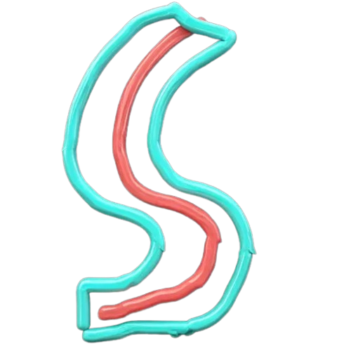

# EliteIcons Icon Studio

<p align="center">
  
</p>

A browser-based visual editor for designing, previewing, importing, editing, and exporting EliteIcons in SVG and PNG formats.

**Live site:** https://eliteicons.github.io/Icon-Studio/

## Overview

Icon Studio provides a compact 24 by 24 editing surface with drawing tools, geometry controls, transforms, animation previews, live SVG markup editing, and direct export actions. It runs entirely in the browser and does not require a backend or API credentials.

The editor starts with a lightning-bolt path and can be used to create a new icon from lines, rectangles, circles, and freehand strokes.

## Features

- Draw on a 24 by 24 grid with line, rectangle, circle, and pen tools
- Snap pointer coordinates to the nearest grid position
- Toggle a visible 24 by 24 pixel grid
- Adjust stroke color, stroke width, and line cap style
- Rotate icons 90 degrees left or right
- Flip icons horizontally or vertically
- Undo drawing actions and canvas clears
- Import existing SVG markup
- Edit the generated SVG source directly
- Preview spin, pulse, bounce, ping, and wiggle animations
- Copy reusable animation CSS to the clipboard
- Copy the generated SVG to the clipboard
- Download SVG files
- Export icons as 512-pixel PNG images
- Responsive layout that collapses into a vertical workspace on smaller screens

## Technology

- **TypeScript:** application logic, state, canvas interaction, and exports
- **HTML:** Vite entry document
- **CSS:** custom dark, grid-based interface
- **Vite 6:** development server and production bundling
- **TypeScript 5:** strict ES2020 browser source compilation
- **GitHub Actions:** automated build and GitHub Pages deployment

There are no application runtime dependencies beyond the browser APIs and the local TypeScript/Vite development toolchain.

## Getting Started

### Prerequisites

- Node.js 20 or newer
- npm

### Install

```bash
git clone https://github.com/EliteIcons/Icon-Studio.git
cd Icon-Studio
npm install
```

### Start the development server

The package does not define a dedicated `dev` script, so run Vite directly:

```bash
npm exec vite
```

Vite prints the local URL in the terminal. Open that URL in a modern browser.

### Build for production

```bash
npm run build
```

The build uses `tsc` for strict type checking and Vite for bundling. Production output is written to `dist/`.

For a quick preview of the production output:

```bash
npm exec vite preview
```

## Using Icon Studio

### Drawing

1. Select **Line**, **Rect**, **Circle**, or **Pen** from the left panel.
2. Move the pointer over the central canvas to view snapped grid coordinates.
3. Press and drag over the SVG canvas.
4. Release the pointer to commit the shape.

The pen tool records each grid point and builds an SVG path. Line, rectangle, and circle previews are rendered by `src/canvas.ts` before being committed to the shared icon state.

### Styling

Use the left panel to change:

- Stroke color
- Stroke width from 1 to 3.5 pixels
- Round, butt, or square line caps
- Grid visibility

The styling controls update the live SVG preview and the generated export markup immediately.

### Transforming

- **-90°** and **+90°** rotate the icon around the 24 by 24 view box center
- **Flip H** mirrors the icon horizontally
- **Flip V** mirrors the icon vertically
- **Undo** restores the previous icon markup
- **Clear Canvas** removes all icon markup while preserving undo history

Icon Studio keeps up to 30 previous markup states in memory.

### Importing SVG

Choose **Paste / Import SVG**, paste complete SVG markup into the dialog, and select **Load into Studio**.

The editor removes the outer `<svg>` element and retains the inner markup in the studio state. Rotate and flip transformations are reset during import.

You can also edit the **Live SVG Code** text area and select **Apply Code to Canvas**. The editor strips an outer SVG tag if present, resets rotation and flips, and applies the remaining markup.

### Animations

The right panel can preview:

- None
- Spin
- Pulse
- Bounce
- Ping
- Wiggle

Select **Copy Animation CSS** to copy the CSS for the active animation to the clipboard.

### Exporting

- **Copy SVG** copies 24-pixel export markup to the clipboard
- **Download .SVG** downloads `elite-icon.svg`
- **Export .PNG (512PX)** rasterizes the current SVG and downloads `elite-icon-512.png`

The PNG exporter draws the generated SVG onto an HTML canvas and converts it to PNG with `canvas.toBlob`.

## Project Structure

```text
Icon-Studio/
├── .github/
│   └── workflows/
│       └── deploy.yml       GitHub Pages build and deployment
├── src/
│   ├── main.ts              DOM setup and application event wiring
│   ├── state.ts             Shared state, transforms, history, and SVG assembly
│   ├── canvas.ts            Pointer drawing and 24 by 24 canvas interactions
│   ├── template.ts          Workbench markup and control layout
│   ├── exporters.ts         SVG, PNG, and animation CSS export actions
│   └── style.css            Full application presentation
├── index.html               Vite HTML entry point
├── vite.config.ts           Vite base-path configuration
├── tsconfig.json            Strict TypeScript configuration
├── package.json             Scripts and development dependencies
└── logo.png                 Application icon
```

## Application Architecture

`index.html` mounts the app through `src/main.ts`. The module injects the workbench markup from `src/template.ts`, imports the stylesheet, locates the canvas and control elements, then connects browser events to shared application state.

`src/state.ts` owns the icon markup, selected tool, color, stroke width, line cap, grid visibility, animation, transformations, and undo history. `buildFullSvg` serializes that state into a complete SVG element for preview and export.

`src/canvas.ts` converts pointer positions into coordinates from 0 through 24 and writes temporary shapes to the overlay SVG. On pointer release, the shape is appended to `state.innerSvg` and history is updated.

`src/exporters.ts` serializes SVG markup and provides clipboard, download, PNG rasterization, and animation CSS actions.

`src/style.css` provides the complete three-panel desktop workspace and a stacked mobile layout. The interface uses a nearly monochrome black-and-gray design with a lime accent.

## Deployment

The repository deploys to GitHub Pages through `.github/workflows/deploy.yml`.

The workflow runs on pushes to `main` and manual dispatch. It:

1. Checks out the repository
2. Installs Node.js 20
3. Runs `npm install --no-audit --no-fund`
4. Runs `npm run build`
5. Uploads `dist/`
6. Deploys the artifact to the GitHub Pages environment

The Vite configuration sets `/Icon-Studio/` as the base path so assets resolve correctly when hosted at:

```text
https://eliteicons.github.io/Icon-Studio/
```

## Development Notes

- Clipboard actions require secure browser context support, generally HTTPS or localhost
- The PNG exporter is fully client-side and does not upload icons
- The app currently stores editing state in memory only
- Reloading the page resets drawings and undo history
- The SVG serializer assumes the icon remains within a 24 by 24 view box
- No test suite or lint configuration is currently included

## Contributing

Contributions are welcome.

1. Fork the repository.
2. Create a focused feature branch.
3. Make the change and run `npm run build`.
4. Test drawing, importing, transforms, animations, and exports in a browser.
5. Open a pull request with a clear summary and testing steps.

Please avoid unrelated formatting changes and keep the interface behavior consistent across desktop and mobile layouts.

## Repository

- **Organization:** [EliteIcons](https://github.com/EliteIcons)
- **Repository:** [EliteIcons/Icon-Studio](https://github.com/EliteIcons/Icon-Studio)
- **Live app:** https://eliteicons.github.io/Icon-Studio/
